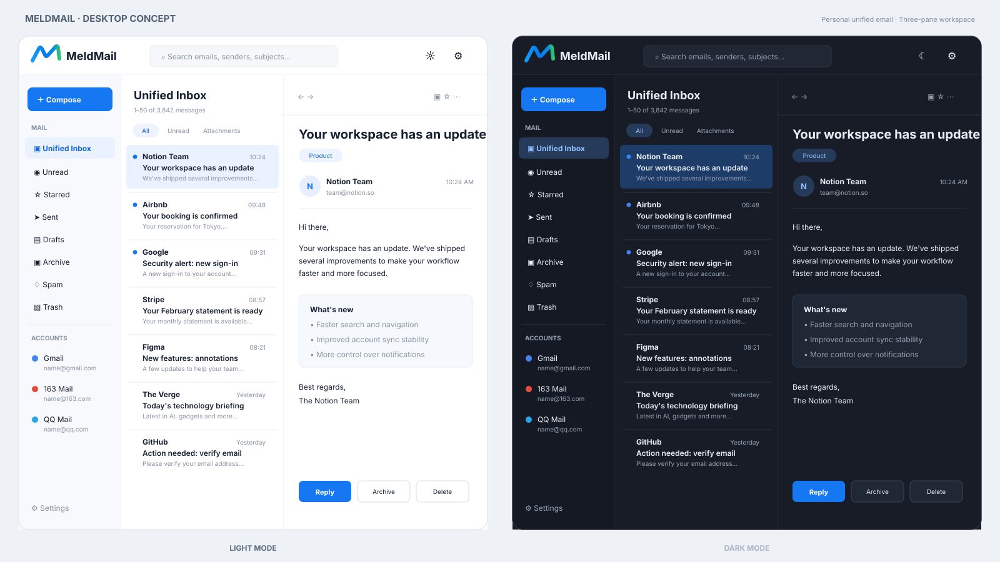

<p align="center">
  
</p>
<h1 align="center">MeldMail</h1>
<p align="center">Self-hosted multi-account email · Per-account proxies · One container</p>
<p align="center">
  <a href="README.md">简体中文</a> · <strong>English</strong>
  <br>
  <a href="#quick-deployment">Quick start</a> · <a href="docs/OPERATIONS.en.md">Operations</a>
</p>

**Route each mailbox independently.** For example, connect Gmail through a SOCKS5 proxy, keep QQ Mail direct, and use another HTTP(S) CONNECT proxy for a work mailbox. New mailboxes connect directly by default and can opt into a shared proxy. [Proxy setup](docs/OPERATIONS.en.md#mailboxes-and-proxies)



Desktop Light and Dark design reference; available features follow the current implementation. [Design guide](docs/DESIGN.md)

## Features

- Unified inbox with search, background IMAP sync, and live updates.
- Read, send, reply, forward, and stream attachments. HTTP(S) links open in new tabs.
- Archive and restore messages, permanently delete individual Trash messages, or empty Trash per account.
- Control MCP access with revocable tokens, send approvals, and audit logs.
- Chinese and English UI, light and dark themes, and mobile layouts.

## Quick deployment

Requires Docker Engine, Docker Compose v2.20+, Git and OpenSSL. Run these commands on the server:

```sh
git clone https://github.com/Nyakooo/meldmail.git
cd meldmail
[ -f .env ] || cp .env.example .env
chmod 600 .env
openssl rand -hex 32
```

Edit `.env`: put the generated key in `MELDMAIL_MASTER_KEY` and set the MeldMail sign-in password:

```dotenv
MELDMAIL_HTTP_PORT=18085
MELDMAIL_MASTER_KEY=replace_with_the_generated_64_hex_characters
MELDMAIL_ADMIN_PASSWORD='replace_with_a_strong_password'
# MELDMAIL_HOST_PROXY_PORT=7890
```

`MELDMAIL_HOST_PROXY_PORT` is optional. On Linux, set it to the deployment server’s local HTTP or mixed proxy port. It applies to mailboxes that select **Use shared proxy**. Set dedicated proxies in the web UI. [Host proxy setup](docs/OPERATIONS.en.md#optional-host-proxy-port-linux)

Passwords are limited to **72 bytes**, not 72 Unicode characters. Single quotes preserve characters such as `$` and `#` instead of interpreting them as Compose interpolation or comments. Do not commit `.env`.

Once the [GHCR publishing workflow](https://github.com/Nyakooo/meldmail/actions/workflows/ghcr.yml) has succeeded, run:

```sh
./deploy.sh
```

The service listens on `127.0.0.1:18085` by default. Use the operations guide to configure external HTTPS access, updates, or backups.

## Local development

Requires Go 1.24+, Node.js 20.19+ and npm. Build the frontend before compiling Go:

```sh
npm ci --prefix web
npm run build --prefix web
# Set the master key and initial password in your shell; go run does not load .env.
go run ./cmd/meldmail
```

For a Docker source build, run `docker compose up --build -d`. Follow [AGENTS.md](AGENTS.md) for incremental testing. Run the full `go test -race ./...` for final acceptance or shared foundation changes.

## Documentation

- [Operations, Nginx, troubleshooting, updates and backups](docs/OPERATIONS.en.md)
- [API, protocol and development reference](docs/DEVELOPMENT.en.md) · [Specification](SPEC.md) · [Acceptance evidence](docs/ACCEPTANCE.md)
- [Apache-2.0 license](LICENSE) · [Third-party notices](THIRD_PARTY_NOTICES.md)
