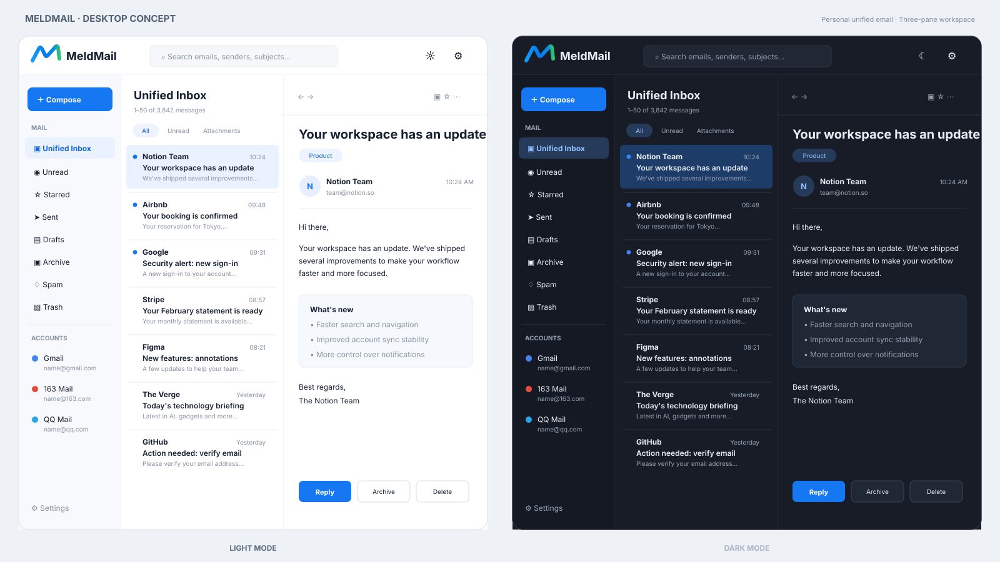
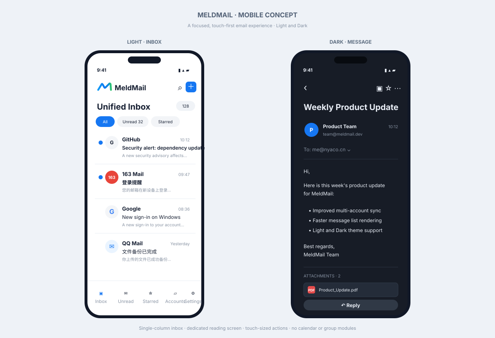

# MeldMail visual design and brand guide

## Product identity

MeldMail is a personal, self-hosted email aggregation client. Its interface should feel like a focused, modern mail tool rather than a general-purpose collaboration suite.

**Design principles**
- Dense but orderly: prioritize useful mail rows and clear alignment over decorative whitespace.
- Calm and modern: restrained surfaces, subtle separators, consistent typography and a single blue action color.
- Fast to scan: sender, subject, snippet, time, unread state, account and attachment indicators remain easy to distinguish.
- Theme-complete: Light and Dark modes cover navigation, lists, reading, dialogs, menus, forms and hover/focus states.
- Personal-first: account management is for the owner's connected mailboxes, not teams or shared workspaces.

## Official logo

The approved mark is a flowing ribbon-shaped **M** with rounded ends and a horizontal blue-to-green gradient. Use the vector assets as the source of truth:

- `assets/brand/meldmail-logo.svg`: horizontal mark and wordmark for README, website and promotional use.
- `assets/brand/meldmail-mark.svg`: symbol-only version.
- `web/public/meldmail-mark.svg`: symbol used by the web client.
- `web/public/favicon.svg`: browser favicon.

Do not replace the mark with a generic envelope, letter tile, gradient square or unrelated icon. Keep clear space around the mark and do not stretch, recolor or add effects to it.

Brand gradient:
- Blue: `#149CF5`
- Core blue: `#0876F2`
- Cyan-blue: `#078EDB`
- Green accent: `#31C66B`

The wordmark uses the project spelling **MeldMail**.

## Desktop layout

Use a stable three-column workspace:

1. **Navigation rail** — compose action, mail folders and connected accounts.
2. **Message list** — compact rows with sender, subject, snippet, time, unread marker, account and attachment/star indicators.
3. **Reading pane** — message header, body, attachments and reply/forward actions.

The top toolbar contains global search, filters, synchronization status/action, theme toggle and settings. Keep column boundaries and row alignment consistent. Avoid oversized cards, excessive shadows, oversized empty states and decorative charts.

## Mobile layout

Mobile is a purpose-designed single-column experience, not a scaled-down desktop layout:

- A compact top bar provides navigation, search and compose access.
- The inbox uses full-width, touch-friendly message rows.
- A bottom navigation bar provides the core destinations: Inbox, Unread, Starred, Accounts and Settings.
- Opening a message moves to a dedicated reading screen with a clear back action.
- Reply and forward actions remain reachable without requiring desktop-style toolbars.
- Account switching opens a compact selector or sheet.
- Compose is reachable from a persistent floating action.

The mobile navigation must not introduce calendar, contacts or group features.

## Theme direction

### Light

- App canvas: cool near-white.
- Main surfaces: white.
- Dividers: subtle cool gray.
- Primary text: deep charcoal.
- Secondary text: muted slate.
- Primary action and selected states: clear blue.

### Dark

- App canvas: deep charcoal, not pure black.
- Main surfaces: slightly lighter charcoal panels.
- Dividers: low-contrast slate.
- Primary text: soft white.
- Secondary text: muted cool gray.
- Primary action and selected states: the same blue identity, adjusted for contrast.

Theme selection should support Light, Dark and System. Persist the user's explicit choice. Avoid changing the brand gradient between themes.

## Product scope: deliberately excluded

MeldMail is a personal email aggregation system. Do not add these as primary product modules:

- Calendar or scheduling
- Contacts/address-book management
- Groups, teams, shared inboxes or collaboration spaces
- Tasks, project boards, CRM or unrelated productivity modules

Keep the product centered on connecting multiple mailboxes and handling their messages reliably.

## Status of the mockups

The SVG mockups in this guide are design references and brand direction. They are not a claim that the exact pictured layout or all pictured controls are already implemented. Implementation should follow the existing product specification and be delivered incrementally without introducing unnecessary runtime dependencies.
